# Deadlock City

**An Interactive 3D Operating System Resource Management, Deadlock Analysis, and Concurrency Experimentation Platform**


---

## 1. Project Overview

**Deadlock City** turns core Operating Systems internals—process scheduling, resource allocation, Banker's Algorithm deadlock avoidance, multi-instance Wait-For deadlock detection, victim/preemption/checkpoint recovery, and POSIX thread synchronization—into a live, deterministic **futuristic industrial 3D city** backed by an authoritative **C++17 simulation engine**.

Instead of static textbook tables or disconnected JavaScript animations, every building, resource facility, glowing allocation conduit, graph edge, telemetry chart, and comparative experiment is driven by **one canonical `SimulationState`** computed inside compiled C++17 code (`deadlock_engine`), orchestrated by **FastAPI**, streamed over **WebSockets**, and visualized in real time with **Three.js / React Three Fiber**, **React Flow**, and **Recharts**.

---

## 2. Problem Statement

Operating Systems concepts such as Coffman's deadlock conditions, the distinction between **unsafe states** and **actual deadlocks**, why **cycles in multi-instance Resource Allocation Graphs (RAGs)** do not always imply deadlock, and race/circular-wait failures in multithreaded synchronization are notoriously difficult to internalize from static matrix hand-calculations alone. Existing teaching tools rarely combine interactive 3D spatial state inspection, step-by-step algorithmic traces (`Work` / `Finish` vectors), live thread synchronization monitoring, and reproducible comparative experimentation on a single source of truth.

---

## 3. Motivation

- **Single Algorithmic Source of Truth**: Keep all OS algorithms (`BankersAlgorithm`, `DeadlockDetector`, `RecoveryManager`, `CPUScheduler`, `SyncLab`) strictly in compiled **C++17** so frontend and backend layers never drift or duplicate logic.
- **Clarity Over Toy Visuals**: Map abstract kernel state directly onto city infrastructure—process buildings encode `NEW/READY/RUNNING/WAITING/BLOCKED/TERMINATED` states, resource facilities display instance pools, and conduits visually separate normal allocations (`cyan`), pending requests (`amber dashed`), multi-instance non-deadlock cycles (`amber`), and confirmed deadlocks (`crimson`).
- **Experimentation Workflow**: Support deterministic seeded workloads, non-mutating hypothetical Banker checks, isolated A/B comparisons, bounded historical telemetry charts, and machine-readable CSV/JSON exports suitable for B.Tech OS lab coursework and viva evaluation.

---

## 4. Key Features

- **Interactive 3D City Visualization**: Procedural industrial city built with Three.js / React Three Fiber / `@react-three/drei`, dynamic telemetry HUD, entity inspector rail, radial control core, Low/Med/High graphics profiles, camera presets (`Iso`, `Top`, `Focus Selected`), and an automatic **2D Tactical SVG Fallback** when WebGL is unavailable or `prefers-reduced-motion` is preferred.
- **Interactive Resource Allocation Graph & Wait-For Graph**: `@xyflow/react` node-link canvas with custom Process and Resource nodes, directed Allocation (`Resource -> Process`) and Request (`Process -> Resource`) edges, Wait-For Graph projection, auto-layout, and cycle-vs-deadlock differentiation.
- **Deadlock Detection Laboratory**: Authoritative C++ matrix detection + step-by-step `Work` / `Finish` trace playback (`Play`, `Pause`, `Next`, `Prev`, `Reset`) and plain-language root-cause explanation.
- **Banker's Algorithm Workbench**: Live `Allocation`, `Max`, `Need`, and `Available` matrices with non-mutating **hypothetical request checks** alongside actual state-mutating allocations.
- **Deadlock Recovery & Checkpoint Center**: Confirmation-gated execution of `Terminate All Deadlocked`, `Terminate Victim` (lowest cost, lowest priority, least allocated, lowest remaining work), `Preempt Resource`, and `Rollback Checkpoint` with before/after diffs (including partial recovery synchronization via HTTP `409` + WebSocket).
- **Process & Resource Manager**: Create, suspend, resume, or terminate processes; add resource pools; scale resource instances; submit or release requests at runtime.
- **CPU Scheduling Gantt Laboratory**: Side-by-side comparison across **FCFS**, **SJF**, **SRTF**, **Non-preemptive Priority**, and **Round Robin** (`quantum`), rendering color-coded Gantt timelines with idle gaps, context switch counts, turnaround/waiting/response metrics, and CPU utilization.
- **Real Multithreaded Synchronization Lab (`std::thread`)**: Live C++ executions of **Producer-Consumer**, **Readers-Writers**, and **Dining Philosophers** in both `safe` (`std::mutex` + `std::condition_variable`) and `unsafe` experimental modes with timeline scrubbers and anomaly counters.
- **Analytics Command Center & Exports**: 8 synchronized Recharts panels over a bounded 240-sample / 200-event sliding telemetry window with CSV/JSON downloads and a print-ready `@media print` experiment summary sheet.

---

## 5. Application Screenshots

| 3D City Overview (`SAFE`) | Confirmed Deadlock & Alert Conduits |
| :---: | :---: |
| 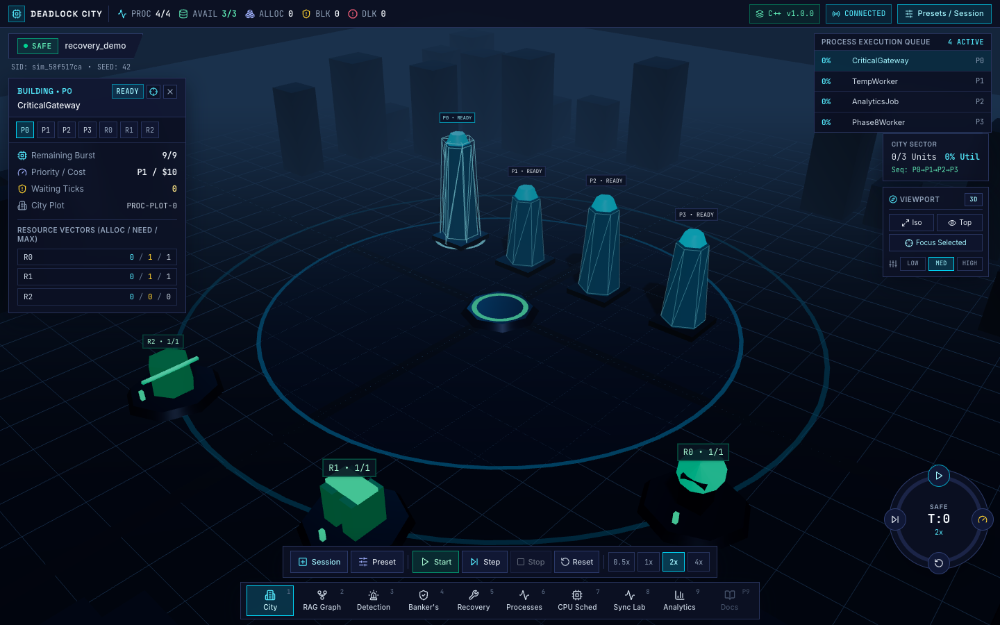 | 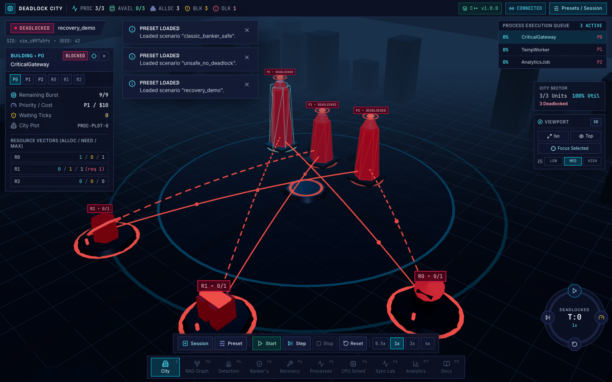 |

| Interactive RAG & Wait-For Graph | Deadlock Detection Stepper |
| :---: | :---: |
| 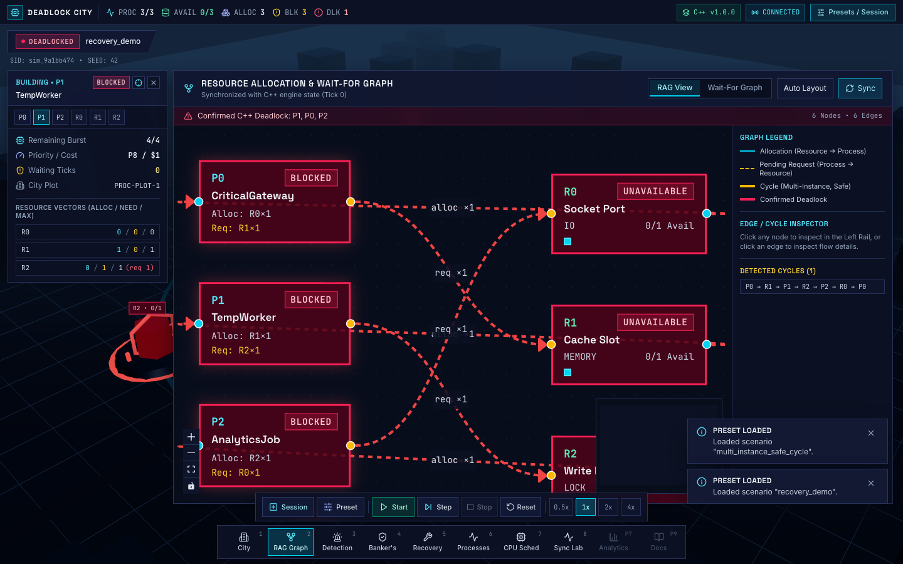 | 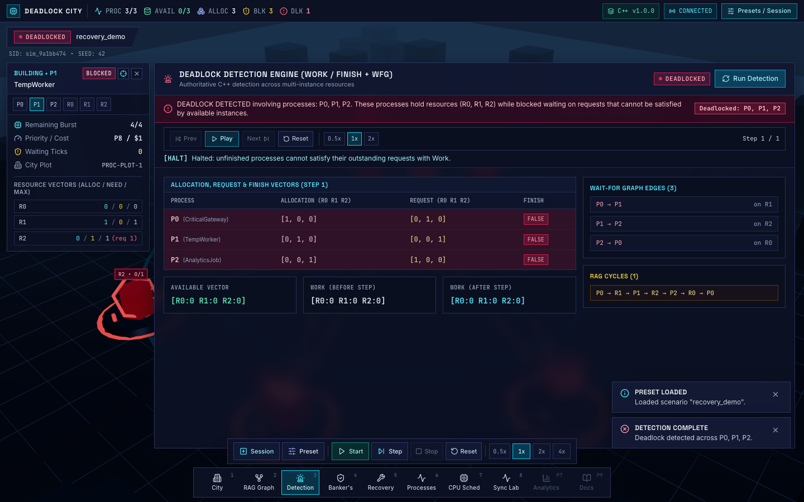 |

| Banker's Algorithm Workbench | Deadlock Recovery Center |
| :---: | :---: |
| 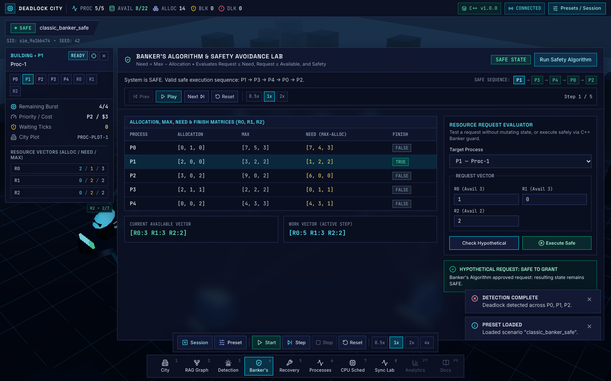 | 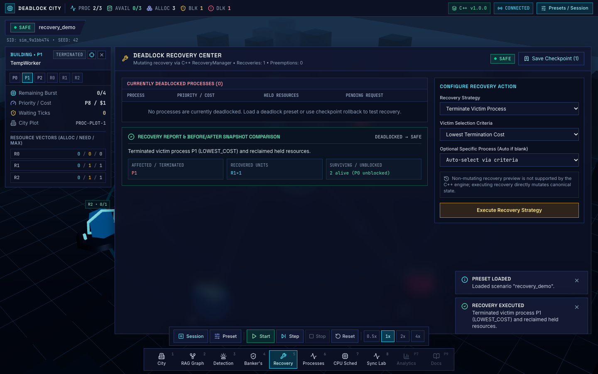 |

| CPU Scheduling Gantt Lab | C++ Synchronization Lab |
| :---: | :---: |
| 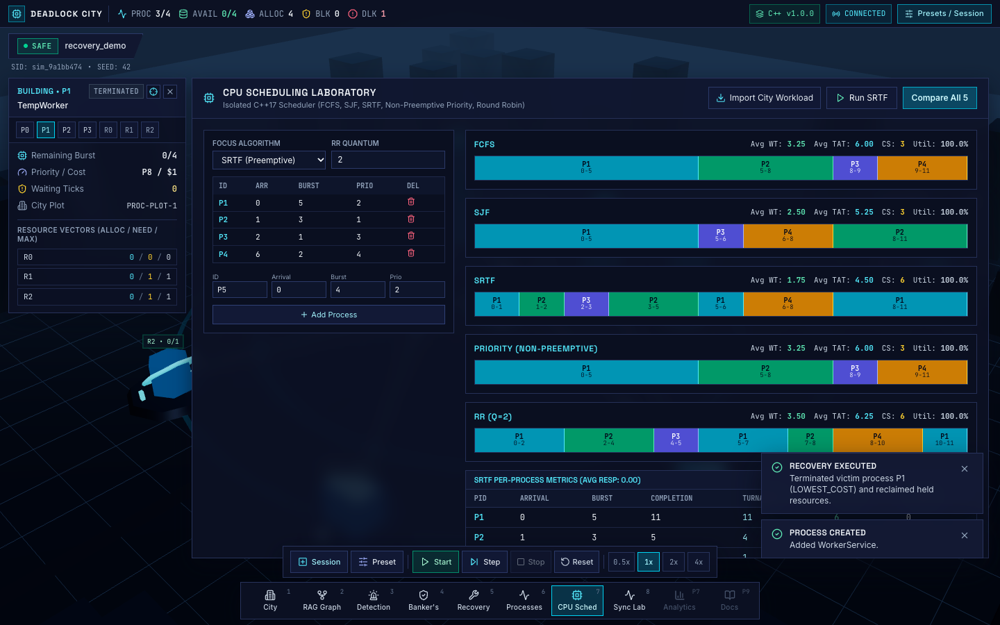 | 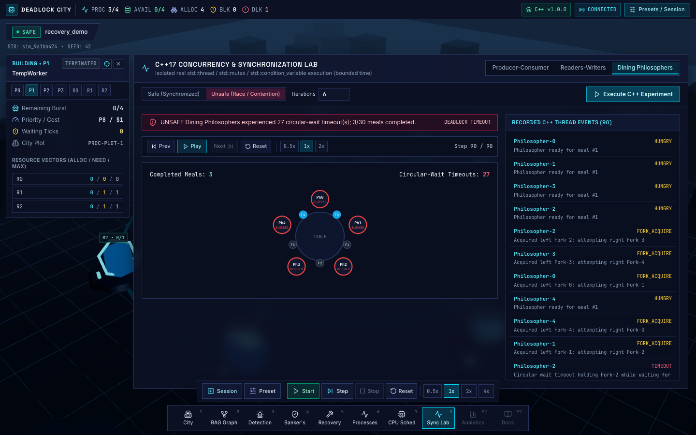 |

| Analytics Command Center | Historical Telemetry Charts & Comparisons |
| :---: | :---: |
| 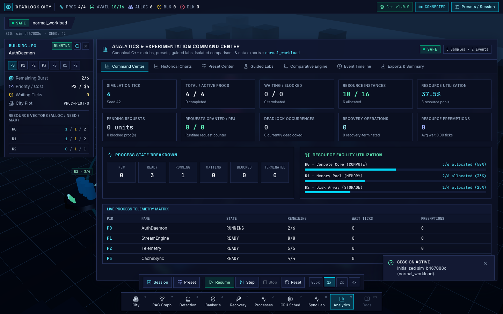 | 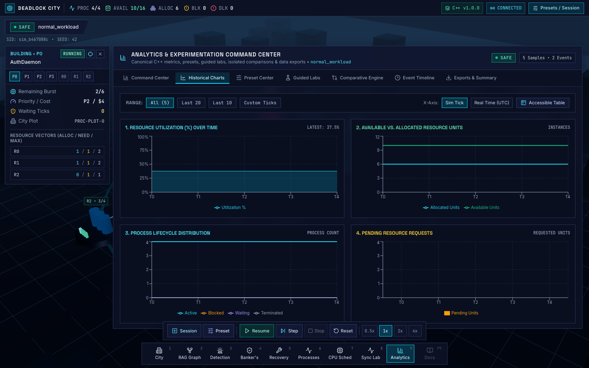 |

---

## 6. Technology Stack

| Tier | Technologies |
| :--- | :--- |
| **Core Simulation Engine** | C++17 (`-Wall -Wextra -Wpedantic`), CMake 3.16+, `nlohmann/json` 3.11.3, GoogleTest 1.14.0, C++ STL `<thread>` / `<mutex>` / `<condition_variable>` |
| **Backend Orchestration** | Python 3.11+ (verified on 3.12 container / 3.14 host), FastAPI, Pydantic v2, Uvicorn, WebSockets, `asyncio.create_subprocess_exec`, Pytest |
| **Frontend Visualization** | React 18, TypeScript 5.6 (strict), Vite 5, Tailwind CSS v4, Three.js (`0.169`), `@react-three/fiber`, `@react-three/drei`, `@xyflow/react`, Recharts, Framer Motion, Zustand, Vitest + Testing Library |
| **Deployment & Tooling** | Docker multi-stage builds (`debian:bookworm-slim`, `python:3.12-slim`, `node:20-alpine`, `nginx:1.27-alpine`), Docker Compose, Bash automation (`scripts/*.sh`) |

---

## 7. System Architecture

Deadlock City follows a strict three-tier architecture so OS algorithm state never drifts between frontend, backend, and simulation layers:

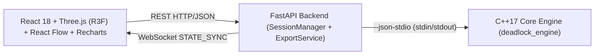

For detailed sequence, state, data-flow, IPC, and Docker diagrams, see [docs/architecture.md](docs/architecture.md).

---

## 8. Repository Structure

```text
Deadlock City/
├── engine/                     # Authoritative C++17 simulation engine & GoogleTest suite
│   ├── CMakeLists.txt
│   ├── include/                # Types, Process/Resource/Recovery managers, Banker, Detector, Scheduler, SyncLab
│   ├── src/                    # C++17 implementations & CLI entrypoint (main.cpp)
│   └── tests/                  # 24 C++ unit & JSON IPC integration tests
├── backend/                    # FastAPI orchestration API, WebSocket hub, exports, Pytest suite
│   ├── app/
│   │   ├── api/                # health.py, simulation.py, labs.py
│   │   ├── engine/bridge.py    # Async subprocess runner + semaphore + domain error mapping
│   │   ├── schemas/            # Pydantic v2 models
│   │   ├── services/           # SessionManager (LRU eviction, auto-tick), graph_builder, export_service
│   │   └── websocket/hub.py
│   └── tests/                  # 15 Pytest API & service integration tests
├── frontend/                   # Vite + React + TypeScript + R3F + React Flow + Recharts UI
│   └── src/
│       ├── analytics/          # Command center, charts, presets, guided labs, comparisons, timeline, exports
│       ├── city/               # Three.js city canvas, buildings, facilities, conduits, camera rig, 2D fallback
│       ├── components/         # Shared tactical UI widgets & NativeDialog
│       ├── dashboard/          # Telemetry bar, left inspector, bottom dock, radial core, session modal
│       ├── graph/              # React Flow RAG & WFG nodes/edges
│       ├── services/           # Typed API client & WS reconnect manager
│       ├── simulation/         # Detection, Banker, Recovery, Process/Resource, CPU Sched, Sync Lab
│       ├── stores/             # Zustand state store with stale-seq rejection
│       └── test/               # 23 Vitest frontend component & store tests
├── docker/                     # Non-root backend/frontend Dockerfiles & Nginx proxy config
├── docs/                       # Architecture, Algorithms, API, User Guide, Academic Report & Viva Guides
├── scripts/                    # Cross-platform setup.sh, dev.sh, and test.sh scripts
├── docker-compose.yml
├── .dockerignore
├── .env.example
└── README.md
```

---

## 9. Prerequisites

### Docker Deployment
- Docker Engine 24+ and Docker Compose v2 (`docker compose`)

### Native Local Build
- **C++17 compiler** (`clang++` on macOS or `g++` on Linux) and **CMake 3.16+**
- **Python 3.11+** (with `venv` and `pip`)
- **Node.js 20+** and **npm 10+**

---

## 10. Installation & Startup

### Option A: Docker Compose (Recommended)

```bash
docker compose up --build
```

Open [http://localhost:8080](http://localhost:8080) in your browser. Nginx serves the production React/Three.js bundle on port `8080` and proxies `/api/*` and `/ws/*` to the internal `backend:8000` FastAPI container.

Stop containers cleanly with:

```bash
docker compose down
```

### Option B: Native Setup & Development

Copy environment defaults if customization is needed (optional):

```bash
cp .env.example .env
```

Install dependencies and compile the C++17 binary cleanly:

```bash
./scripts/setup.sh
```

Start FastAPI (`127.0.0.1:8000`) + Vite dev server (`127.0.0.1:5173`):

```bash
./scripts/dev.sh
```

Open [http://127.0.0.1:5173](http://127.0.0.1:5173).

---

## 11. Testing Commands

Run the entire C++, Python, lint, Vitest, and production TypeScript build suite:

```bash
./scripts/test.sh
```

Individual suite commands:

```bash
# C++17 GoogleTest suite (24 tests)
ctest --test-dir engine/build --output-on-failure

# Optional C++ Sanitizer builds (verified on Linux GCC 13 ASan+UBSan/TSan and macOS Clang UBSan)
cmake -S engine -B engine/build-ubsan -DENABLE_UBSAN=ON && cmake --build engine/build-ubsan -j4 && ./engine/build-ubsan/deadlock_tests

# Backend Pytest suite (15 tests)
backend/.venv/bin/pytest backend/tests -q

# Frontend ESLint, Vitest (23 tests), and Vite build
npm --prefix frontend run lint
npm --prefix frontend test
npm --prefix frontend run build
```

---

## 12. Supported OS Algorithms & Experiment Presets

### Implemented OS Algorithms ([docs/algorithms.md](docs/algorithms.md))
- **Deadlock Avoidance**: Banker's Safety Check and Banker's Resource Request Evaluation (`Need = Max - Allocated`, overflow & cumulative-request validation)
- **Deadlock Detection**: Single-instance RAG / Wait-For Cycle Enumeration (`DeadlockDetector::find_rag_cycles`) and Multi-Instance `Work`/`Finish` Matrix Detection (`DeadlockDetector::detect`)
- **Deadlock Recovery**: `terminate_all`, `terminate_victim` (4 victim criteria), `preempt_resource`, and `rollback` (verified against remaining cycles so unresolved deadlocks return `DEADLOCK_UNRESOLVED`)
- **CPU Scheduling**: `FCFS`, `SJF`, `SRTF`, Non-preemptive `Priority`, and `Round Robin` (`quantum`)
- **Thread Synchronization**: Real C++17 `std::thread` experiments (`Producer-Consumer`, `Readers-Writers`, `Dining Philosophers`) in synchronized (`safe`) and race/timeout (`unsafe`) modes

### Authoritative Simulation Presets
1. `normal_workload` — Balanced 4-process city workload (`SAFE`)
2. `classic_banker_safe` — Textbook 5-process, 3-resource safe sequence `P1 -> P3 -> P4 -> P0 -> P2` (`SAFE`)
3. `single_instance_deadlock` — Classic `P0 <-> P1` circular wait over single-unit locks (`DEADLOCKED`)
4. `multiple_instance_deadlock` — Multi-unit saturated circular wait across `R0`, `R1` (`DEADLOCKED`)
5. `multi_instance_safe_cycle` — RAG cycle that resolves cleanly without deadlock (`SAFE`)
6. `unsafe_no_deadlock` — Zero safe completion sequences yet zero blocked cycles (`UNSAFE`, not deadlocked)
7. `resource_starvation` — Low-priority batch job delayed behind competing allocations
8. `high_contention` — Near-saturated resource pools with active waiting processes
9. `recovery_demo` — 3-process deadlock pre-loaded with a clean checkpoint (`Tick 0`) for rollback recovery

---

## 13. API Overview

All HTTP routes sit under `/api` and WebSocket streams under `/ws/simulation/{session_id}`:

- `GET /api/health` — Backend readiness + live `deadlock_engine --health` check
- `POST /api/simulation/create`, `GET/POST /api/simulation/{id}/{state,start,pause,resume,stop,step,reset,checkpoint,workload/random}`
- `POST/PATCH/DELETE /api/simulation/{id}/{process,resource,request,release}`
- `GET /api/simulation/{id}/{graph,deadlock}`, `POST /api/simulation/{id}/{banker/check,recovery}`
- `POST /api/scheduling/compare`, `POST /api/synchronization/run`
- `GET /api/analytics/{id}`, `GET /api/analytics/{id}/export`
- `GET /api/experiments/presets`, `POST /api/experiments/{run,compare,export}`

See full payloads, error codes (`400`, `404`, `409`, `413`, `422`, `503`, `504`), and C++ IPC command documentation in [docs/api.md](docs/api.md).

---

## 14. Measured Performance Benchmarks

Measured locally on Apple Silicon (macOS Darwin 25.5, 8 GB RAM host; Google Chrome WebGL + Uvicorn + C++17 Release engine):

- **Frontend Production Bundle Optimization**: Eliminated Rollup `Circular chunk` and chunk-size (`>850 kB`) warnings; `three_core` chunk reduced from monolithic `three_vendor` `997.07 kB` (`gzip 275.52 kB`) to `683.40 kB` (`gzip 175.30 kB`), and `AnalyticsCommandCenter` lazy chunk dropped from `473.24 kB` (`gzip 122.00 kB`) to `80.96 kB` + shared `charts_vendor` (`379.86 kB`).
- **610-Second (10+ Minute) Sustained Multi-Session Stress Run** (`21` checkpoints sampled every `30s` on a `12×6` workload at `4x` speed with concurrent session steps, tab cycling, and `SyncLab` calls):
  - **Sustained Frame Rate**: `60.0 FPS` mean / `60.0 FPS` min average / `59.5 FPS` min 5th-percentile low (`16.8 ms` max frame delta)
  - **Chrome JS Heap (`Runtime.getHeapUsage`)**: `41.15 MB` -> `46.20 MB` (`26.56–47.98 MB` GC sawtooth, zero monotonic leak)
  - **FastAPI Backend RSS & FDs**: `57.28 MB` -> `40.92 MB`, FDs flat at `60 -> 61`
  - **Median Latency**: C++ IPC binary `--health` `8.92 ms`; REST `POST /api/simulation/{id}/step` `32.73 ms`; REST `GET /api/analytics/{id}` `1.52 ms`

---

## 15. Security Considerations

- **No-Shell Subprocess Invocation**: `EngineBridge` uses `asyncio.create_subprocess_exec` with explicit timeouts (`5.0s` standard, `15.0s` synchronization lab) and an `asyncio.Semaphore(8)` concurrency cap.
- **Request & Session Bounds**: HTTP request bodies are capped at `1 MiB` (`413 PAYLOAD_TOO_LARGE`); session registry enforces `DEADLOCK_MAX_SESSIONS=100` with idle-only LRU eviction; entities are bounded to `24` processes and `12` resource types (`1–64` instances).
- **CORS & WebSocket Origin Validation**: FastAPI enforces local/configured origins on both HTTP CORS and WebSocket `Upgrade` (`1008` policy violation close on untrusted origins).
- **Dependency Scans**: `npm --prefix frontend audit --omit=dev` -> `0 vulnerabilities`; `pip-audit -r backend/requirements.txt` -> `No known vulnerabilities found`.
- **Scope Caveat**: Intended for single-user / classroom local lab deployment; does not implement user authentication, multi-tenant ACLs, or TLS termination directly (place behind a reverse proxy for shared network hosting).

---

## 16. Known Limitations

- **Simulation vs. Real Kernel**: Deadlock City is an educational discrete-tick OS simulator and user-space synchronization visualizer, **not** an OS kernel or hypervisor; real kernel internals such as virtual memory paging, disk I/O scheduling, POSIX named semaphores, and file systems are out of scope.
- **Ephemeral Session Store**: Sessions live in FastAPI process memory and are bounded to 240 retained metric samples and 200 audit events per session (explicitly disclosed in the UI and analytics exports).
- **Per-Command Subprocess Model**: Each engine mutation spawns a short-lived C++ subprocess (~`9–33 ms`), favoring strict crash/memory isolation over ultra-high-frequency (`>100 Hz`) IPC streaming.
- **Host Sanitizer & Browser Coverage**: AppleClang 17 on macOS Darwin 25.5 hits runtime startup issues with `-fsanitize=address` and `-fsanitize=thread`; ASan+UBSan and TSan verification ran in an ARM64 Linux Docker container (`ubuntu:24.04`). Cross-browser automated verification covered Chromium, Firefox `159.0`, and WebKit `27.2`; native macOS `safaridriver` automation requires interactive authorization.

---

## 17. Future Improvements

- Optional persistent SQLite/PostgreSQL session snapshots across server restarts
- Interactive JSON scenario import/export for instructor homework grading suites
- Persistent long-lived C++ worker daemon mode (zero fork overhead) for large batch simulations
- Optional student authentication & classroom lab leaderboard mode

---

## 18. Documentation Index & Contributors

- [docs/architecture.md](docs/architecture.md) — System architecture & Mermaid lifecycle diagrams
- [docs/algorithms.md](docs/algorithms.md) — Formal algorithm specs, complexity, pseudocode, worked examples & test traceability
- [docs/api.md](docs/api.md) — Complete REST, WebSocket, and C++ IPC specification
- [docs/user-guide.md](docs/user-guide.md) — Step-by-step operator and student lab manual
- [docs/project-report.md](docs/project-report.md) — B.Tech 5th-Semester Operating Systems PBL Academic Report
- [docs/course-outcomes.md](docs/course-outcomes.md) — Operating Systems syllabus & Course Outcome mapping
- [docs/demo-guide.md](docs/demo-guide.md) — Reproducible 3-minute, 5-minute, and 10-minute live demo scripts
- [docs/viva-guide.md](docs/viva-guide.md) — 60+ technical OS & architecture viva questions with grounded answers
- [docs/portfolio.md](docs/portfolio.md) — Resume bullets, engineering highlights & interview summary

### Contributors

| Role | Contributor | Contact / ID |
| :--- | :--- | :--- |
| Author / Developer | `[Student / Developer Name Placeholder]` | `[Enrollment ID / GitHub Handle Placeholder]` |
| Faculty Guide | `[Faculty Advisor Name Placeholder]` | `[Department of Computer Science & Engineering Placeholder]` |
