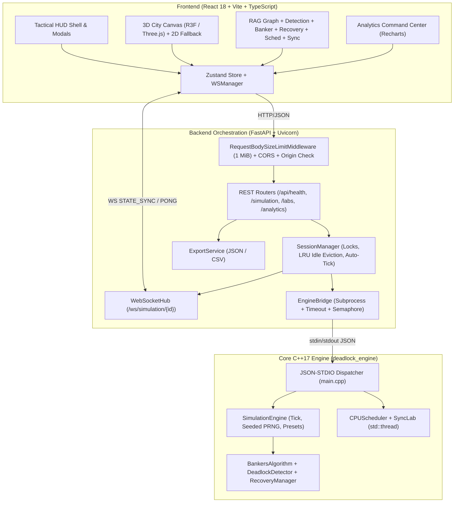
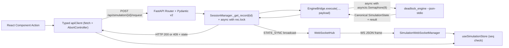
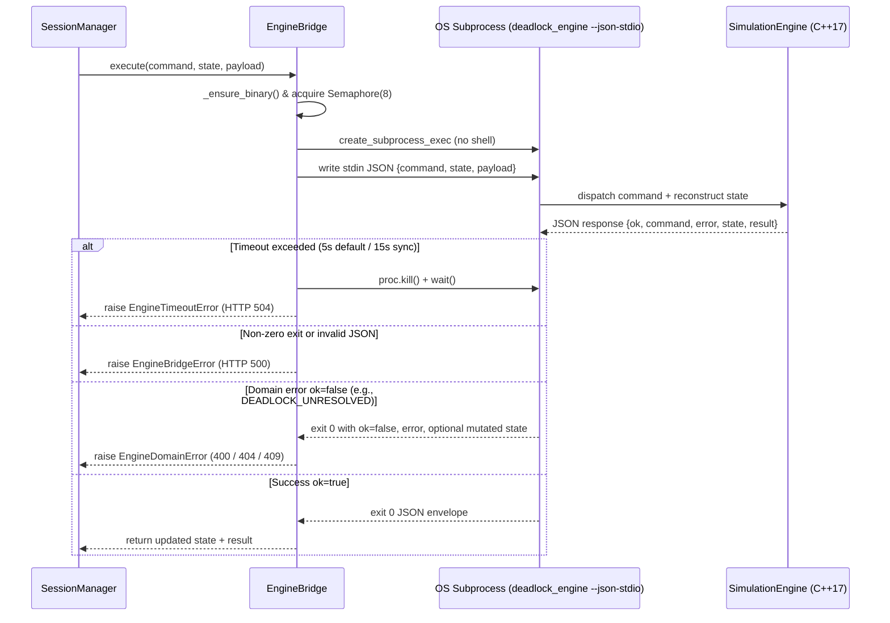
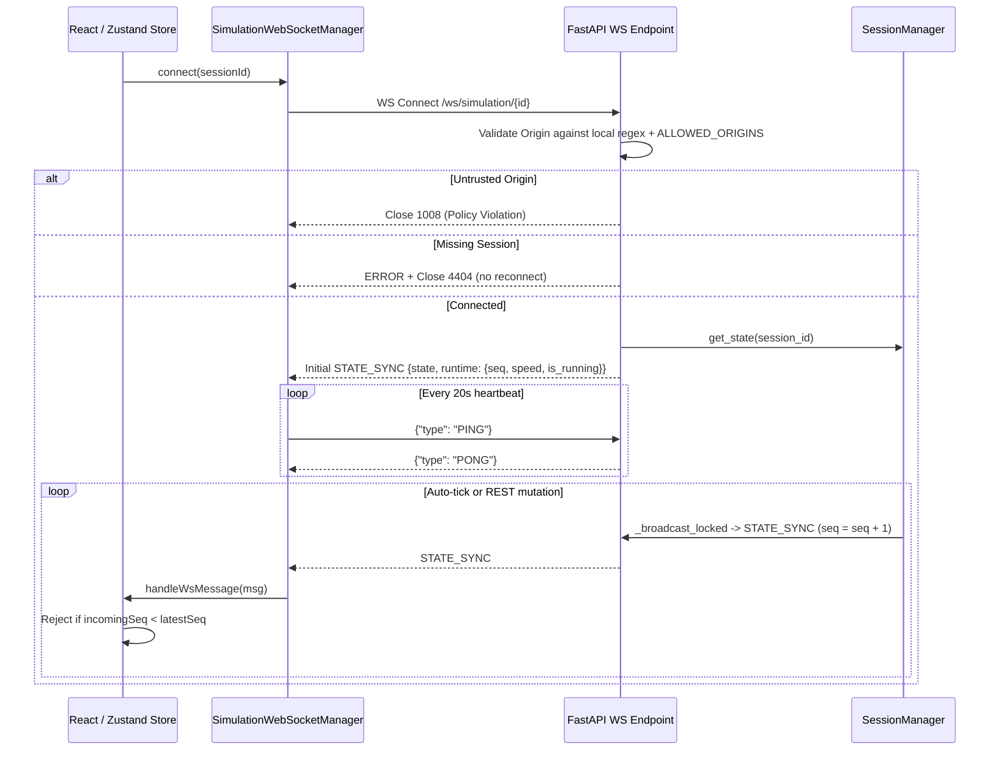
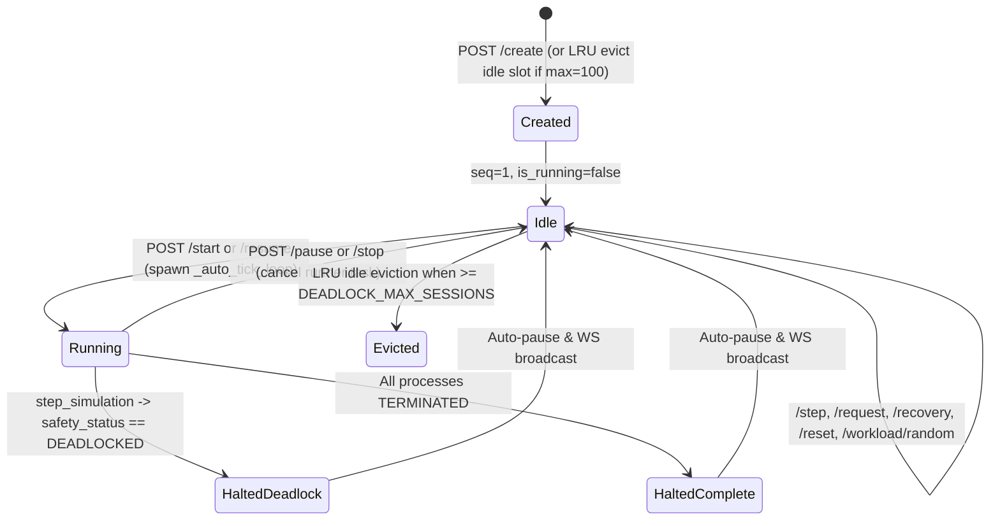
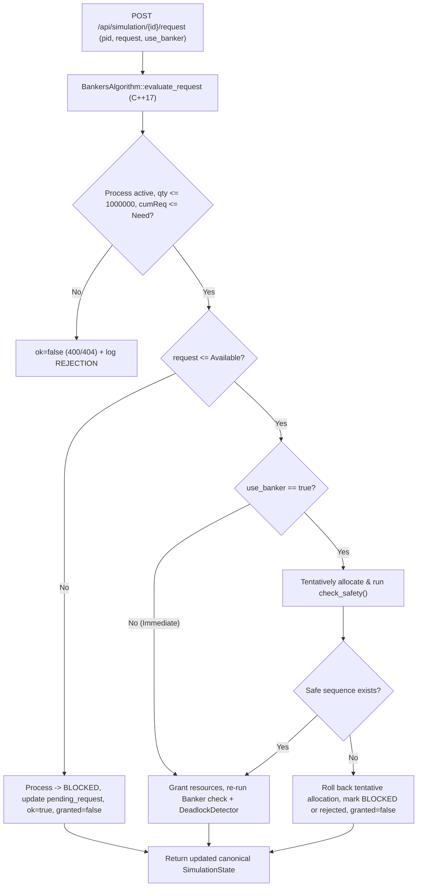
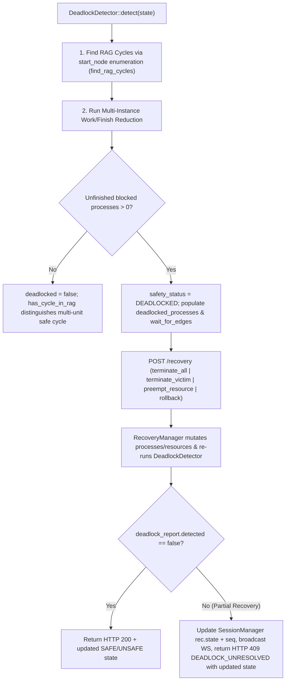
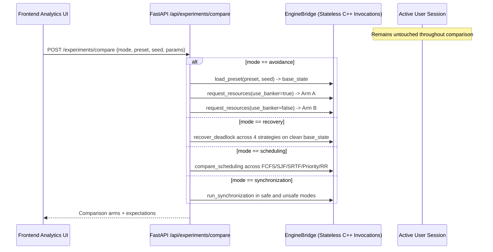
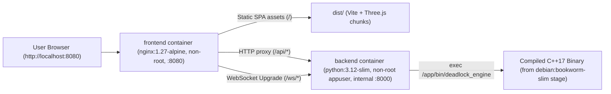

# Deadlock City — System Architecture

Deadlock City is organized into three strictly decoupled tiers: a React 18 + Three.js visualization client, a FastAPI orchestration server, and an authoritative C++17 simulation engine (`deadlock_engine`).

---

## 1. Architectural Rationale & Core Design Choices

### Why C++17 is the Authoritative Simulation Engine
All operating systems algorithms—Banker's safety checks, RAG/WFG cycle enumeration, multi-instance Wait/Finish detection, victim recovery, CPU scheduling simulations, and POSIX thread synchronization—reside strictly in compiled C++17 (`engine/src/`). Compiling to native machine code delivers deterministic seeded PRNG behavior (`std::mt19937`), strict compiler diagnostics (`-Wall -Wextra -Wpedantic`), low-millisecond execution (~`8.9 ms` process startup + IPC roundtrip), hardware-real `std::thread` / `std::mutex` / `std::condition_variable` execution in `SyncLab`, and full compatibility with C++ UndefinedBehaviorSanitizer, AddressSanitizer, and ThreadSanitizer. Neither Python nor TypeScript re-implements any OS decision logic.

### Why FastAPI is Used for Orchestration
FastAPI (`backend/app/`) provides non-blocking `asyncio` orchestration over the C++ CLI subprocess via Pydantic v2 schema validation, structured HTTP error translation (`400`, `404`, `409`, `413`, `422`, `503`, `504`), per-session locking and background auto-tick loops (`SessionManager`), multi-client `WebSocketHub` fanout, and CSV/JSON data formatting (`ExportService`).

### Why React, Three.js, React Flow, and Recharts are Used for Visualization
- **React 18 + TypeScript + Zustand**: Provides a predictable tactical HUD and single client store hydrated strictly from server responses and WebSocket `STATE_SYNC` messages.
- **Three.js / React Three Fiber / Drei**: Renders the procedural 3D industrial city (district blocks, process buildings, resource facilities, animated conduit arcs) smoothly at `60 FPS` with automatic **2D Tactical SVG Fallback** (`CityFallback2D`) when WebGL is disabled or unavailable.
- **React Flow (`@xyflow/react`)**: Displays interactive bipartite Resource Allocation Graphs and Wait-For Graph projections without duplicating cycle/deadlock math.
- **Recharts**: Renders 8 live telemetry time-series panels and accessible tabular alternatives over the bounded historical buffer.

---

## 2. Architecture & Lifecycle Diagrams

### 2.1 Overall System Architecture

### 2.2 Frontend, Backend, and C++ Communication

### 2.3 JSON IPC Request-Response Lifecycle

### 2.4 WebSocket Synchronization & Stale Snapshot Protection

### 2.5 Simulation Session Lifecycle & Auto-Tick Loop

### 2.6 Resource Request Processing (`use_banker` ON vs. OFF)

### 2.7 Deadlock Detection & Recovery Lifecycle

### 2.8 Isolated Comparative Experiment Execution

### 2.9 Docker Deployment Architecture

---

## 3. State Consistency, Concurrency & Safety Mechanisms

1. **Canonical Simulation State**: Python stores the full `SimulationState` JSON dictionary per session ID (`SessionRecord.state`) and stamps UTC ISO timestamps onto metrics and events (`_stamp_session_timestamps`). Every C++ mutation accepts the previous state JSON, mutates deterministically, trims `metrics_history` to `240` samples and `events` to `200` records while preserving monotonic `total_metric_samples_recorded` and `total_events_recorded`, and returns the authoritative replacement snapshot.
2. **Session Isolation**: Each session gets a unique `sim_<8hex>` identifier and its own `SessionRecord` with dedicated `asyncio.Lock`, `runner_task`, `wakeup_event`, and sequence counter `seq`. Isolated comparative experiments execute directly against `EngineBridge` without touching `SessionManager._sessions`. `SessionManager` caps live storage (`DEADLOCK_MAX_SESSIONS=100`) and evicts only least-recently-used **idle** sessions (`not is_running`, `0` active WebSocket connections, unlocked).
3. **Concurrent Mutation Synchronization**: Every HTTP endpoint mutating session `{id}` and every background `_auto_tick_loop` iteration acquires `async with rec.lock` before invoking `EngineBridge.execute(...)` or updating `rec.state`. Thus auto-ticks and manual user requests (`step`, `request`, `recovery`, `reset`) are strictly serialized per session.
4. **Subprocess Lifecycle & Safety**: `EngineBridge` never invokes a shell (`create_subprocess_exec`), guards concurrent spawns with `asyncio.Semaphore(DEADLOCK_MAX_ENGINE_CONCURRENCY=8)`, enforces wall-clock timeouts (`5.0s` simulation, `15.0s` `run_synchronization`), kills + reaps timed-out subprocesses cleanly, and translates domain errors (`400`, `404`, `409`) separately from crash/timeout failures (`500`, `504`). Even when `DEADLOCK_UNRESOLVED` (`409`) occurs after partial victim termination, `SessionManager` persists `exc.state`, bumps `rec.seq`, broadcasts `STATE_SYNC`, and returns updated `state`/`result` in the `409` body.
5. **Stale Frontend Snapshot Rejection**: FastAPI increments monotonic `rec.seq` on every state change (REST responses embed `result.runtime.seq` and WebSocket frames embed `runtime.seq`). Both `applyEnvelope` and `handleWsMessage` in `useSimulationStore.ts` discard incoming snapshots within the same session if `incomingSeq < latestSeq`, preventing slower out-of-order HTTP responses from overwriting newer WebSocket ticks.
