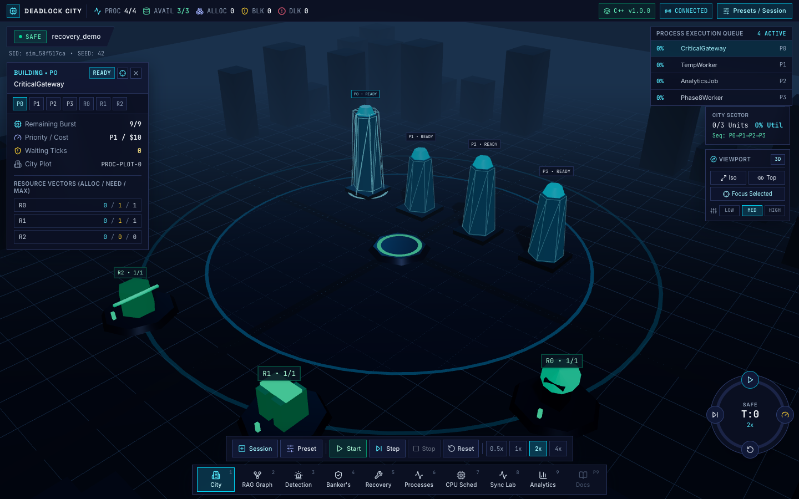
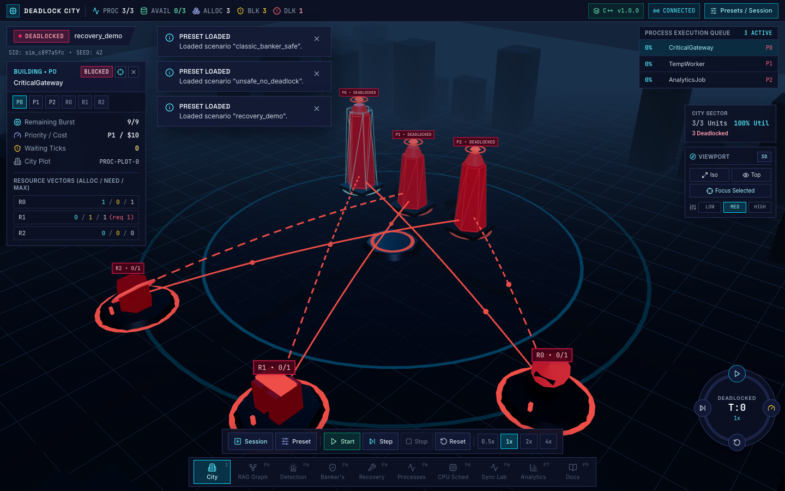
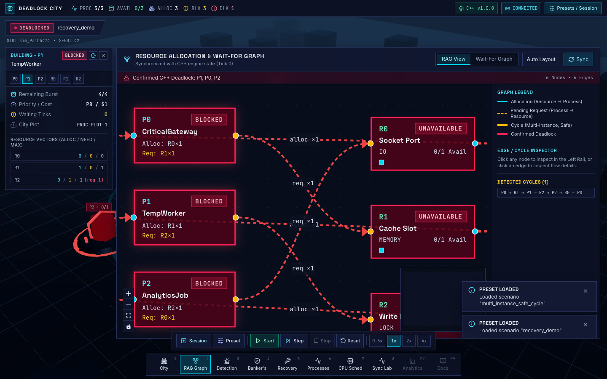
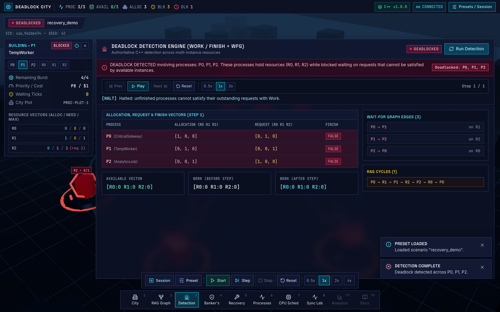
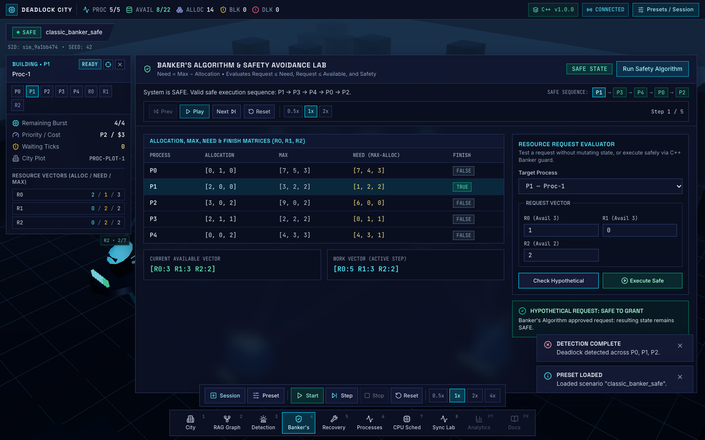
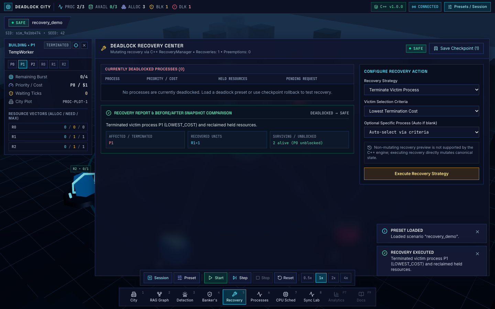
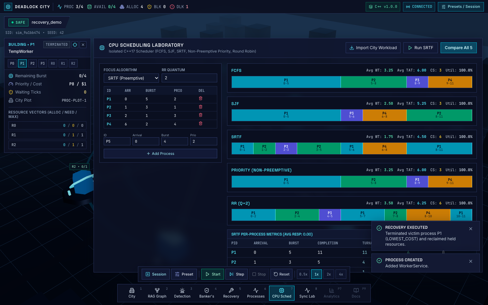
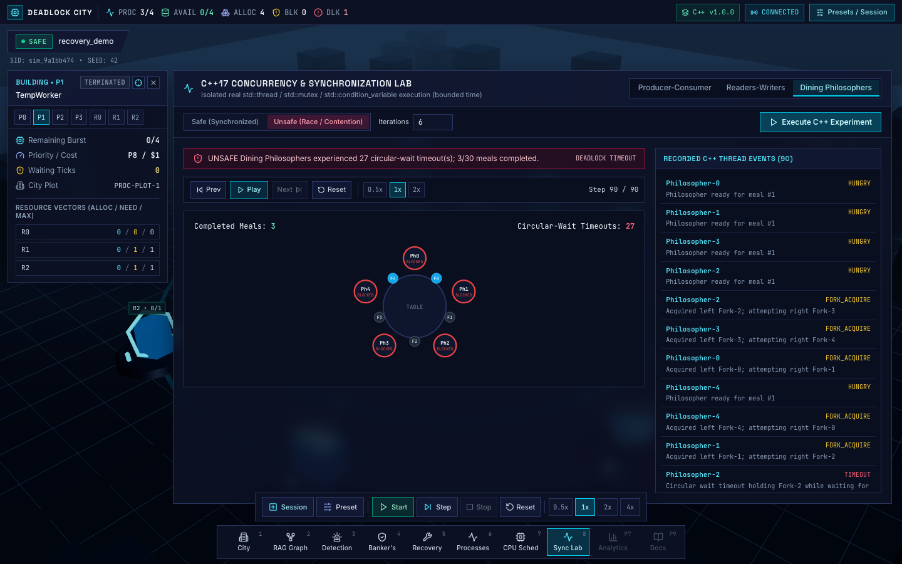
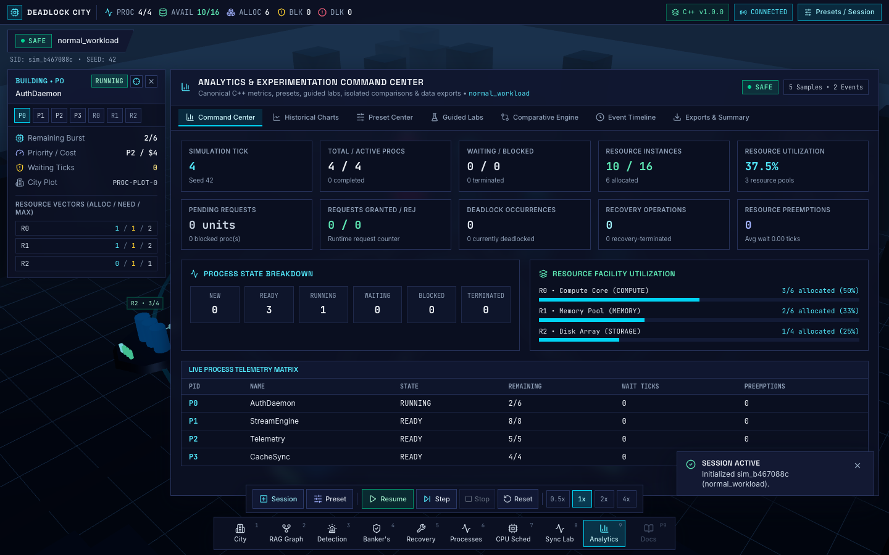
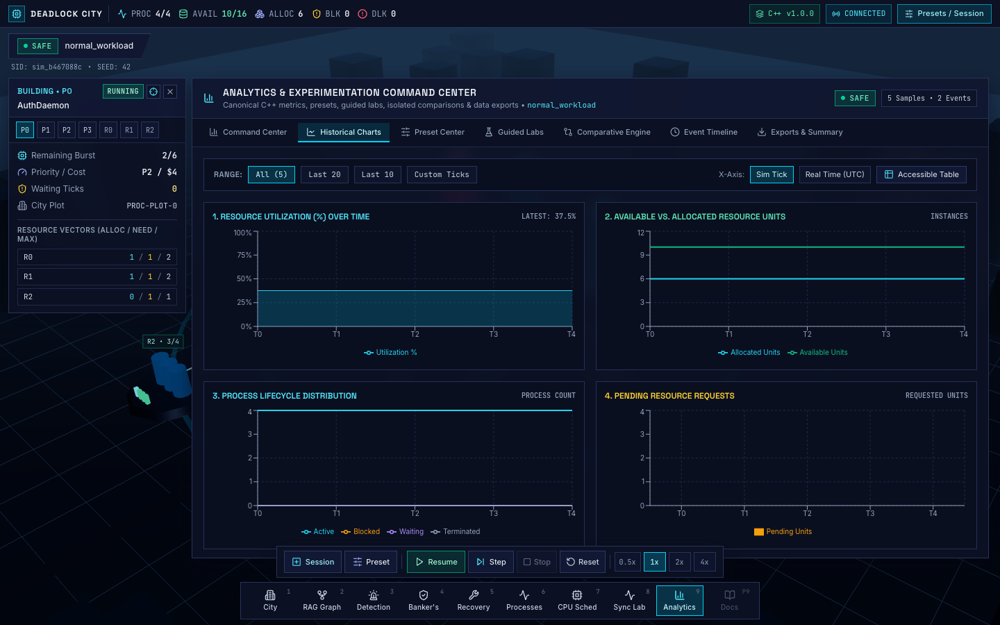

# Deadlock City: An Interactive 3D Operating System Resource Management and Deadlock Simulation Platform

**Project-Based Learning (PBL) Technical Report**  
*Fifth Semester — B.Tech in Computer Science & Engineering (Operating Systems)*

---

## 1. Title Page

- **Project Title**: Deadlock City: An Interactive 3D Operating System Resource Management and Deadlock Simulation Platform
- **Course**: Operating Systems (B.Tech — 5th Semester)
- **Submitted By**: `[Student Name Placeholder]` (`[University Roll Number / Enrollment ID Placeholder]`)
- **Team Members** *(if applicable)*: `[Member 2 Placeholder]`, `[Member 3 Placeholder]`
- **Guided By**: `[Faculty Supervisor Name & Designation Placeholder]`
- **Institution**: `[Department of Computer Science & Engineering, University / Institute Name Placeholder]`
- **Academic Term**: `[Semester / Academic Year Placeholder]`

---

## 2. Certificate *(Placeholder)*

> This is to certify that the project report entitled **"Deadlock City: An Interactive 3D Operating System Resource Management and Deadlock Simulation Platform"** is a bona fide record of project work carried out by **`[Student Name Placeholder]`** (`[Enrollment ID Placeholder]`) under the supervision of **`[Faculty Supervisor Placeholder]`** in partial fulfillment of the requirements for the fifth-semester Operating Systems Laboratory during `[Academic Year Placeholder]`.
>
> **Supervisor Signature**: `____________________`  
> **Head of Department Signature**: `____________________`  
> **Date**: `____________________`

---

## 3. Declaration *(Placeholder)*

> I/We hereby declare that the work presented in this project report titled **"Deadlock City: An Interactive 3D Operating System Resource Management and Deadlock Simulation Platform"** is authentic work carried out for academic evaluation. All algorithmic implementations, benchmarks, and test outcomes cited in this report reflect verified measurements observed in this codebase.
>
> **Student Signature(s)**: `____________________`  
> **Date**: `____________________`

---

## 4. Acknowledgement

We gratefully acknowledge **`[Faculty Supervisor Placeholder]`** and the Department of Computer Science & Engineering (`[Institute Name Placeholder]`) for guidance on Operating Systems concurrency theory, deadlock analysis, and software verification methodologies.

---

## 5. Abstract

Operating Systems education relies heavily on mastering subtle interactions among process lifecycles, mutual exclusion, resource requests, graph cycles, safety sequences, and multithreaded synchronization. Traditional classroom exercises rely on static matrix worksheets that obscure why **unsafe states** differ from **deadlocked states**, why **multi-instance Resource Allocation Graph cycles** do not always imply deadlock, and how race conditions emerge in concurrent code.

**Deadlock City** addresses this challenge with a deterministic, full-stack three-tier platform:
1. A native **C++17 core engine (`deadlock_engine`)** serving as the single algorithmic source of truth (`ProcessManager`, `ResourceManager`, `DeadlockDetector`, `BankersAlgorithm`, `RecoveryManager`, `CPUScheduler`, and real POSIX `std::thread` `SyncLab`).
2. A **FastAPI backend** orchestrating isolated sessions, `--json-stdio` subprocess IPC, WebSocket `STATE_SYNC` broadcasting, bounded telemetry history, and CSV/JSON exports.
3. A **React 18 + Three.js (`@react-three/fiber`) + React Flow + Recharts** tactical HUD visualizing processes as architectural towers, resources as engineered pools, allocations/requests as live conduits, and step-by-step algorithm traces.

Verified on local Apple Silicon and containerized ARM64 Linux (`Docker`), all automated suites pass (`24/24` C++ GoogleTests clean under Linux `ASan+UBSan` & `TSan`, `15/15` Pytest integration tests, `23/23` Vitest UI/store tests, `20/20` end-to-end browser workflows), sustaining `60.0 FPS` across a continuous 10-minute (`610s`) stress run.

---

## 6. Table of Contents

1. Title Page  
2. Certificate Placeholder  
3. Declaration Placeholder  
4. Acknowledgement  
5. Abstract  
6. Table of Contents  
7. Introduction  
8. Problem Statement  
9. Project Objectives  
10. Scope  
11. Theoretical Background  
12. Functional Requirements  
13. Non-Functional Requirements  
14. Technology Stack  
15. System Architecture  
16. System Design  
17. Data Models  
18. Algorithm Implementations  
19. Module Descriptions  
20. User Interface Screenshots  
21. Testing Methodology  
22. Test Cases and Results  
23. Performance Analysis  
24. Security Considerations  
25. Results and Discussion  
26. Limitations  
27. Future Scope  
28. Conclusion  
29. References  

---

## 7. Introduction

Understanding Operating Systems resource management requires building mental models across time, concurrency, and matrix invariants simultaneously. When students run `ps`, `top`, or textbook tables, structural dependencies—such as process `P0` holding resource `R0` while blocked on `R1` held by `P1`—remain implicit. **Deadlock City** externalizes those invariants inside an interactive 3D metropolis synchronized with a bipartite Resource Allocation Graph (`React Flow`), matrix workbenches (`Banker's`, `Detection`, `Recovery`), Gantt timelines (`CPU Sched`), and real `std::thread` traces (`Sync Lab`).

---

## 8. Problem Statement

Existing educational OS tools suffer from three structural gaps:
1. **Logic Fragmentation**: Web visualizers frequently compute OS safety checks in browser JavaScript, drifting from systems programming semantics or mocking thread races instead of running native synchronization primitives.
2. **Conceptual Conflation**: Static diagrams fail to let learners step dynamically through **SAFE -> UNSAFE -> DEADLOCKED** transitions or distinguish an amber **multi-instance cycle** from a confirmed **circular-wait deadlock**.
3. **Lack of Integrated Experimentation**: Rarely do learners get isolated A/B comparisons, bounded live telemetry graphs, machine-readable CSV/JSON exports, and reproducible seeded presets inside a single unified workspace.

---

## 9. Project Objectives

- Build an authoritative **C++17** engine computing all OS algorithms deterministically without duplicating algorithm logic in Python or TypeScript.
- Architect a responsive **FastAPI + WebSocket** orchestration layer supporting isolated concurrent sessions, non-blocking IPC, timeouts, and data export.
- Construct a **60 FPS interactive 3D City** (`Three.js` / R3F) paired with an automatic **2D Tactical SVG Fallback** for non-WebGL accessibility.
- Provide dedicated laboratories for **RAG/WFG**, **Detection**, **Banker's Algorithm**, **Recovery**, **Process/Resource Management**, **CPU Scheduling (`FCFS`, `SJF`, `SRTF`, `Priority`, `RR`)**, **Synchronization (`std::thread`)**, and **Analytics/Presets/Exports**.
- Verify correctness and stability through unit/integration tests, memory/thread sanitizers, multi-browser checks, Docker packaging, and sustained stress benchmarking.

---

## 10. Scope

- **In Scope**: Process PCB lifecycle simulation (`24` processes max), resource pool management (`12` pools max, `1..64` units), RAG/WFG analysis, Banker's avoidance, victim/preemption/rollback deadlock recovery, 5 CPU scheduling algorithms, 3 real C++ multithreaded synchronization benchmarks, bounded historical telemetry (`240` metrics / `200` events), isolated A/B comparisons, CSV/JSON export, and native + Docker deployment.
- **Out of Scope**: Hardware interrupts, page replacement/virtual memory, disk scheduling, file systems, POSIX named semaphores, user accounts/authentication, and persistent multi-node database storage.

---

## 11. Theoretical Background

Deadlock City builds directly upon canonical OS concepts:
- **Coffman Conditions**: Deadlock requires *Mutual Exclusion*, *Hold and Wait*, *No Preemption*, and *Circular Wait* simultaneously.
- **Resource Allocation Graph Theory**: Single-instance cycles guarantee deadlock; multi-instance cycles (`multi_instance_safe_cycle`) do not if unblocked holders can release needed units.
- **Banker's Avoidance (Dijkstra)**: Evaluates `Work >= Need` across all processes assuming worst-case future requests; `UNSAFE` implies absence of a guaranteed safe sequence, not necessarily an active circular wait.
- **CPU Scheduling Metrics**: Waiting time $W_i = T_{turn,i} - B_i$, turnaround time $T_{turn,i} = C_i - A_i$, response time $R_i = F_i - A_i$.
- **Monitor Synchronization**: Mutual exclusion (`std::mutex`) and condition signaling (`std::condition_variable::wait_for`) preventing lost updates, buffer overflows/underflows, reader-writer races, and unordered circular fork acquisition.

---

## 12. Functional Requirements

| ID | Requirement | Verification |
| :--- | :--- | :--- |
| FR1 | Initialize/reset deterministic simulation sessions from 9 presets or custom seed (`2..12` × `2..6`). | `SimulationEngineIPCTest`, Preset Center |
| FR2 | Render live 3D city buildings, facilities, and allocation/request/deadlock conduits (+ 2D fallback). | `cityPhase5.test.tsx`, Chrome/WebKit/Firefox |
| FR3 | Inspect RAG & Wait-For Graph with cycle vs. deadlock warning classification. | `ragPhase6a.test.tsx` |
| FR4 | Execute multi-instance `Work`/`Finish` detection & Banker safety checks (incl. hypothetical non-mutating requests). | `detectionAndBankerPhase6bc.test.tsx`, `test_banker_and_detection.cpp` |
| FR5 | Execute deadlock recovery (`terminate_all`, `terminate_victim`, `preempt_resource`, `rollback`) with partial `409` sync. | `recoveryAndManagementPhase6de.test.tsx`, `test_api_e2e.py` |
| FR6 | Compare 5 CPU scheduling algorithms with Gantt charts & explicit `IDLE` intervals. | `schedulingAndSyncPhase6fg.test.tsx`, `CPUSchedulerTest` |
| FR7 | Execute bounded `std::thread` synchronization labs (`safe` vs `unsafe`). | `SyncLabTest`, Linux TSan |
| FR8 | Display live KPIs, 8 historical Recharts graphs, timeline navigation, A/B comparisons, and CSV/JSON exports. | `analyticsPhase7.test.tsx`, `test_api_e2e.py` |

---

## 13. Non-Functional Requirements

- **Correctness**: Zero compiler warnings (`-Wall -Wextra -Wpedantic`), zero sanitizer findings (Linux `ASan+UBSan+TSan`), zero duplicated OS math in frontend/backend.
- **Performance**: Smooth 3D rendering (`60.0 FPS`), sub-50 ms standard API step response (`32.73 ms` median), code-split bundles under `700 kB` chunk warning limit.
- **Reliability & Security**: No-shell subprocess spawns (`create_subprocess_exec`), `5s/15s` subprocess timeouts, `Semaphore(8)` concurrency limit, `1 MiB` HTTP body cap (`413`), `100` idle-LRU session cap, WebSocket `Origin` enforcement (`1008`), monotonic `seq` stale-snapshot protection.
- **Accessibility & Portability**: Semantic `<dialog>`, keyboard navigation, visible focus outlines, `@media print` academic sheet, `prefers-reduced-motion` support, Docker Compose + Linux/macOS bash scripts.

---

## 14. Technology Stack

- **Core**: C++17, CMake (`3.16+`), `nlohmann/json 3.11.3`, GoogleTest `1.14.0`, STL `<thread>/<mutex>/<condition_variable>`
- **Backend**: Python (`3.12` container / `3.14` host), FastAPI (`0.165.0`), Pydantic v2 (`2.14.4`), Uvicorn (`0.54.0`), WebSockets (`17.4`), Pytest (`9.2.0`)
- **Frontend**: React `18.3.1`, TypeScript `5.6.3`, Vite `5.4.21`, Three.js `0.169.0`, `@react-three/fiber 8.17`, `@react-three/drei 9.122`, `@xyflow/react 12.3.5`, Recharts `2.13.3`, Zustand `5.0.1`, Framer Motion `11.11.17`, Tailwind CSS `4.0`, Vitest `2.1.9`
- **Containerization**: Multi-stage Docker (`debian:bookworm-slim`, `python:3.12-slim`, `node:20-alpine`, `nginx:1.27-alpine`)

---

## 15. System Architecture & 16. System Design

Deadlock City cleanly isolates deterministic algorithmic calculation inside `deadlock_engine`, session state coordination inside FastAPI (`SessionManager`, `EngineBridge`, `WebSocketHub`, `ExportService`), and visualization inside React/Zustand (`frontend/src/`). Complete architecture, sequence, state, and deployment diagrams are documented in [architecture.md](architecture.md).

---

## 17. Data Models

Authoritative schemas in [engine/include/Types.hpp](../engine/include/Types.hpp), [docs/schemas/engine-ipc.schema.json](schemas/engine-ipc.schema.json), and [backend/app/schemas/simulation.py](../backend/app/schemas/simulation.py) govern:
- **`Process`**: `id`, `name`, `arrival_time`, `burst_time`, `remaining_time`, `priority` (`1..10`), `state`, `max_demand`, `allocated`, `need`, `pending_request`, `city_position`, `termination_cost`, `waiting_ticks`, `preemption_count`.
- **`ResourceType`**: `id`, `name`, `category`, `total_instances`, `available_instances`, `allocated_instances`, `preemptible`, `status`, `city_position`.
- **`SimulationState`**: `tick`, `seed`, `preset`, `status`, `safety_status`, `processes[]`, `resources[]`, `deadlock_report`, `banker_report`, aggregate counters, bounded `events[]` (cap `200`, `total_events_recorded`), bounded `metrics_history[]` (cap `240`, `total_metric_samples_recorded`), and `checkpoints[]`.

---

## 18. Algorithm Implementations & 19. Module Descriptions

Detailed pseudocode, complexity ($O(|P|^2 \cdot |R|)$ safety/detection), worked numeric examples, edge cases, and C++ module inventories are documented in [algorithms.md](algorithms.md):
- `engine/`: `Types`, `ProcessManager`, `ResourceManager`, `BankersAlgorithm`, `DeadlockDetector`, `RecoveryManager`, `CPUScheduler`, `SyncLab`, `SimulationSerializer`, `SimulationEngine`, `main`.
- `backend/`: `main.py`, `api/{health,simulation,labs}.py`, `engine/bridge.py`, `services/{session_manager,graph_builder,export_service}.py`, `websocket/hub.py`.
- `frontend/`: `city/`, `graph/`, `simulation/`, `analytics/`, `dashboard/`, `components/`, `stores/`, `services/`.

---

## 20. User Interface Screenshots

| Main 3D Tactical City (`SAFE`) | Confirmed Deadlock Conduits (`DEADLOCKED`) |
| :---: | :---: |
|  |  |

| Bipartite RAG & Wait-For Graph | Work/Finish Detection Trace |
| :---: | :---: |
|  |  |

| Banker's Safety Workbench | Recovery & Rollback Center |
| :---: | :---: |
|  |  |

| CPU Scheduling Gantt Chart | C++ `std::thread` Sync Lab |
| :---: | :---: |
|  |  |

| Analytics KPIs | Historical Telemetry Charts |
| :---: | :---: |
|  |  |

---

## 21. Testing Methodology & 22. Test Cases and Results

1. **C++ Unit & JSON IPC Suite (`engine/tests/`)**: `24/24` GoogleTests passing via `ctest` (`0.29s`). Covers manager invariants, Banker safety & overflow/cumulative edge cases, overlapping RAG cycle enumeration, partial `DEADLOCK_UNRESOLVED` recovery refusal, CPU scheduler ties/idle gaps, and `SyncLab` safe/unsafe invariants.
2. **Sanitizer Verification**:
   - **macOS UBSan**: `24/24` passed (`62 ms`).
   - **Linux ARM64 Docker ASan+UBSan (`ubuntu:24.04`)**: `24/24` passed (`2832 ms`), `0` memory errors/leaks.
   - **Linux ARM64 Docker TSan (`ubuntu:24.04`)**: `24/24` passed + `10/10` repeats of `SyncLabTest.*Safe*`, `0` data-race warnings.
3. **Backend Pytest Suite (`backend/tests/`)**: `15/15` passed (subprocesses, timeout/malformed JSON/missing binary handling, session isolation, LRU idle eviction & busy capacity guard, telemetry retention disclosure, HTTP `413` body cap, untrusted WS `Origin` rejection, partial recovery HTTP `409` sync, CSV/JSON exports).
4. **Frontend Vitest & Static Checks (`frontend/`)**: ESLint `0` errors, TypeScript `tsc -b` strict clean, `23/23` tests passing across `8` test files (`apiAndWs`, `storeAndControls`, `cityPhase5`, `ragPhase6a`, `detectionAndBankerPhase6bc`, `recoveryAndManagementPhase6de`, `schedulingAndSyncPhase6fg`, `analyticsPhase7`).
5. **E2E, Cross-Browser & Clean Deployment**: Verified all `20` full-stack user workflows cleanly in Playwright (with `0` console/page/HTTP 5xx errors), clean install on a space-containing directory (`/tmp/deadlock city clean test`), and live multi-container `docker compose up --build`.

---

## 23. Performance Analysis

- **Code Splitting**: Splitting pure `three` into `three_core` (`683.40 kB` vs prior `997.07 kB` `three_vendor`) and charting into lazy `AnalyticsCommandCenter` (`80.96 kB`) + `charts_vendor` (`379.86 kB`) removed every Rollup circular-chunk and size warning.
- **610-Second Sustained Stress Benchmark**:
  - `21` checkpoints over `600.1s` under active 12×6 city rendering + 8 background stepping sessions + SyncLab runs.
  - Sustained WebGL FPS: **`60.0 FPS` mean**, `59.5 FPS` worst 5th percentile.
  - Chrome JS Heap: `41.15 MB -> 46.20 MB` (bounded GC sawtooth).
  - Backend RSS: `57.28 MB -> 40.92 MB`; File Descriptors: `60 -> 61`.
  - Median Latencies: `--health` C++ binary `8.92 ms`, REST `/step` `32.73 ms`, REST `/analytics/{id}` `1.52 ms`.

---

## 24. Security Considerations

No-shell `create_subprocess_exec` invocation, wall-clock subprocess timeouts, `Semaphore(8)` concurrency cap, `1 MiB` request body cap (`413`), LRU session bound (`100`), WebSocket `Origin` policy checks (`1008`), non-root Docker runtime users (`appuser` / `nginx`), and clean `npm audit --omit=dev` (`0` vulnerabilities) and `pip-audit -r backend/requirements.txt` (`No known vulnerabilities found`) scans. Single-user/classroom scope without authentication/TLS.

---

## 25. Results and Discussion

Deadlock City successfully bridges textbook OS formalism and interactive visual intuition. Every state change across the 3D buildings, RAG/WFG edges, detection trace, Banker matrices, and analytics charts traces back to one deterministic C++ engine response. Disclosing bounded telemetry retention (`240` metrics / `200` events) and propagating partial recovery state even on HTTP `409` eliminates silent discrepancies common in educational prototypes.

---

## 26. Limitations

1. Simulated discrete ticks rather than OS kernel execution (no paging, disk scheduling, file systems, or named semaphores).
2. In-memory FastAPI session storage resets when the backend stops.
3. Per-command subprocess spawn overhead (`~9–33 ms`) bounds peak tick throughput vs. persistent shared-memory engines.
4. AppleClang 17 host ASan/TSan startup issues required ARM64 Linux Docker containers for ASan/TSan verification.

---

## 27. Future Scope

Persistent SQLite/PostgreSQL session snapshots, instructor scenario import/export packs for automated OS grading, an optional long-lived persistent C++ pipe daemon mode, and multi-student classroom lab dashboards.

---

## 28. Conclusion

Deadlock City delivers a verified, containerized, end-to-end Operating Systems learning and experimentation platform. All 9 engineering phases passed functional, algorithmic, sanitizer, performance, security, and academic documentation audits without compromising single-source-of-truth integrity in C++17.

---

## 29. References

1. Silberschatz, A., Galvin, P. B., & Gagne, G., *Operating System Concepts* (10th ed.), Wiley.
2. Tanenbaum, A. S., & Bos, H., *Modern Operating Systems* (4th ed.), Pearson.
3. Coffman, E. G., Elphick, M., & Shoshani, A. (1971), "System Deadlocks," *ACM Computing Surveys*.
4. Dijkstra, E. W. (1965), *Cooperating Sequential Processes* (Banker's Algorithm).
5. Johnson, D. B. (1975), "Finding All the Elementary Circuits of a Directed Graph," *SIAM J. Comput.*
6. ISO/IEC 14882:2017 (C++17), FastAPI & Pydantic v2 Documentation, Three.js / React Three Fiber & `@xyflow/react` Documentation.
