# Deadlock City — Complete User Guide

This guide covers every interface, laboratory module, keyboard control, analytics chart, and export workflow in **Deadlock City**.

---

## 1. Application Startup & Connectivity

1. Start the application using **Docker Compose** (`docker compose up --build`, open `http://localhost:8080`) or **Native Dev** (`./scripts/dev.sh`, open `http://127.0.0.1:5173`).
2. Look at the **Top Telemetry Bar**:
   - **Engine Status Badge**: Displays `C++ v1.0.0` (green) when FastAPI can invoke `deadlock_engine --health`.
   - **WebSocket Badge**: Shows `CONNECTED` once the real-time `STATE_SYNC` stream is live.
   - **Presets / Session**: Opens the modal dialog to load a preset cleanly or spawn an isolated simulation session.
3. On reload, the browser automatically restores your saved session ID (`deadlock_city_session_id` in `localStorage`) without losing simulation state.

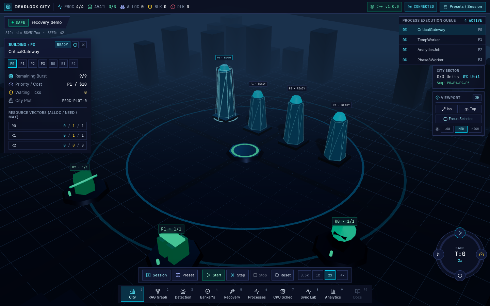

---

## 2. City Navigation, Camera Controls & Graphics Quality

- **Orbit / Pan / Zoom**: Drag left-click inside the 3D city viewport to orbit around the central nexus; right-drag to pan; scroll wheel to zoom.
- **Viewport Panel (Top Right)**:
  - Toggle **`3D` / `2D`**: Switches manually between Three.js WebGL 3D rendering and the built-in **2D Tactical City SVG Map** (`CityFallback2D` also activates automatically if WebGL is unavailable or crashes).
  - **`Iso` / `Top`**: Resets the camera to isometric overview or orthographic-style top-down inspection.
  - **`Focus Selected`**: Smoothly zooms onto whichever process building or resource facility is highlighted in the Left Inspector Rail.
  - **Graphics Presets (`LOW` | `MED` | `HIGH`)**: Controls background skyline density, shadow maps, WebGL pixel ratio (`dpr`), and animated conduit packet spheres.

### Visual Encodings in the City
- **Process Towers** (outer city blocks): Cyan (`READY`), Emerald (`RUNNING`), Indigo (`WAITING`), Amber (`BLOCKED`), Crimson pulsing (`DEADLOCKED`), Slate (`TERMINATED` / `NEW`).
- **Resource Facilities** (inner ring): Distinct industrial shapes by category (`IO`, `LOCK`, `COMPUTE`, `MEMORY`, `STORAGE`) with glowing slot bars showing available vs. allocated units.
- **Conduit Arcs**: Solid cyan lines represent **Allocations** (`Resource -> Process`); dashed amber arcs represent **Pending Requests** or non-deadlocked multi-instance cycles; thick pulsing crimson arcs indicate **Confirmed Deadlock**.

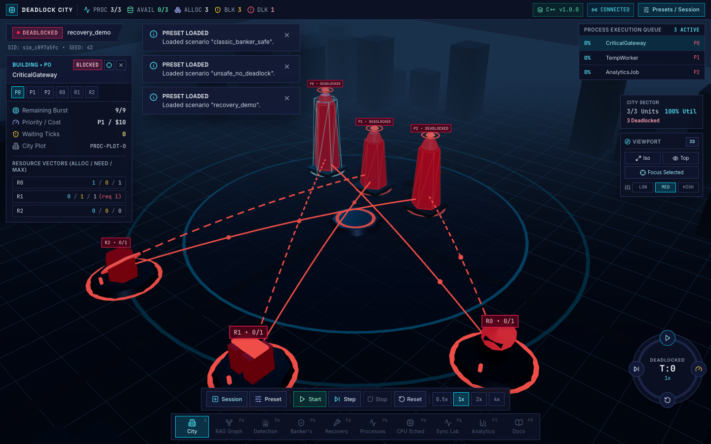

---

## 3. Simulation Lifecycle & Controls

Available in both the **Bottom Contextual Action Toolbar** and the **Radial Control Core** (bottom right):

- **`Session` / `Preset`**: Create a fresh isolated simulation or replace the current session with any of the 9 authoritative C++ presets.
- **`Start` / `Resume` / `Pause` / `Stop`**: Starts or halts the FastAPI server-side auto-tick runner (automatically pauses cleanly when `DEADLOCKED` is entered or all processes complete).
- **`Step` (`+1 Tick`)**: Advances exactly 1 discrete simulation tick in C++, updating burst timers, retrying blocked requests, and re-running `DeadlockDetector`.
- **`Reset`**: Restores tick `0` with the current preset and seed.
- **Speed Selector (`0.5x`, `1x`, `2x`, `4x`)**: Dynamically adjusts auto-tick cadence without resetting state.

---

## 4. Entity Inspector & Process/Resource Queue

- **Top-Right Process Execution Queue**: Lists active non-terminated processes and completion progress; clicking any row selects that process across both the **3D City** and the **Left Inspector Rail**.
- **Left Inspector Rail (`P0..P4`, `R0..R2`)**: Displays live `Remaining Burst`, `Priority` (`P1` highest to `P10` lowest), `Termination Cost`, `Waiting Ticks`, `City Plot`, and exact resource vectors (`ALLOC / NEED / MAX` for processes; `AVAILABLE / ALLOCATED / TOTAL` and `Preemptible` flag for resources).

---

## 5. Module Workbenches (Bottom Navigation Dock)

### 5.1 RAG Graph (`RAG Graph [2]`)
1. Switch between **`RAG View`** (bipartite Process + Resource nodes with directed `Resource -> Process` allocation edges and `Process -> Resource` request edges) and **`Wait-For Graph`** (resource-eliminated `P_wait -> P_holder` projection).
2. Click **`Auto Layout`** to re-arrange nodes deterministically.
3. Hover/inspect warning banners distinguishing an amber **Multi-Instance Cycle (No Deadlock)** from a red **Confirmed Deadlock**.

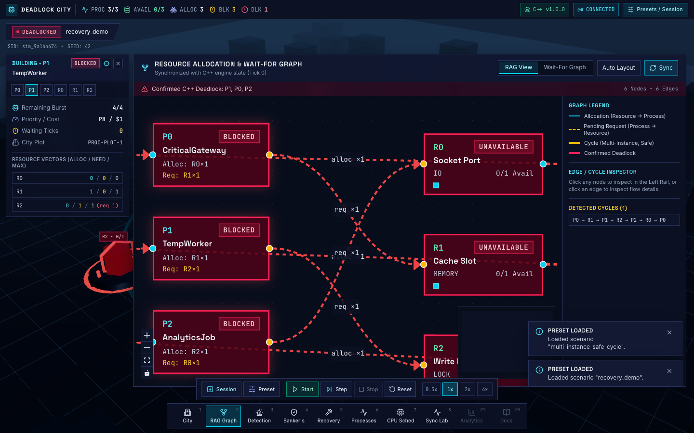

### 5.2 Deadlock Detection Lab (`Detection [3]`)
1. Click **`Run Detection`** to invoke C++ `DeadlockDetector::detect`.
2. Use the **`Work / Finish` Trace Playback Controls** (`Previous`, `Play trace`, `Next`, `Reset`) to inspect step-by-step how `Work` accumulates released allocations or stalls on deadlocked processes.
3. Inspect the **Wait-For Edges** list and plain-language root-cause explanation.

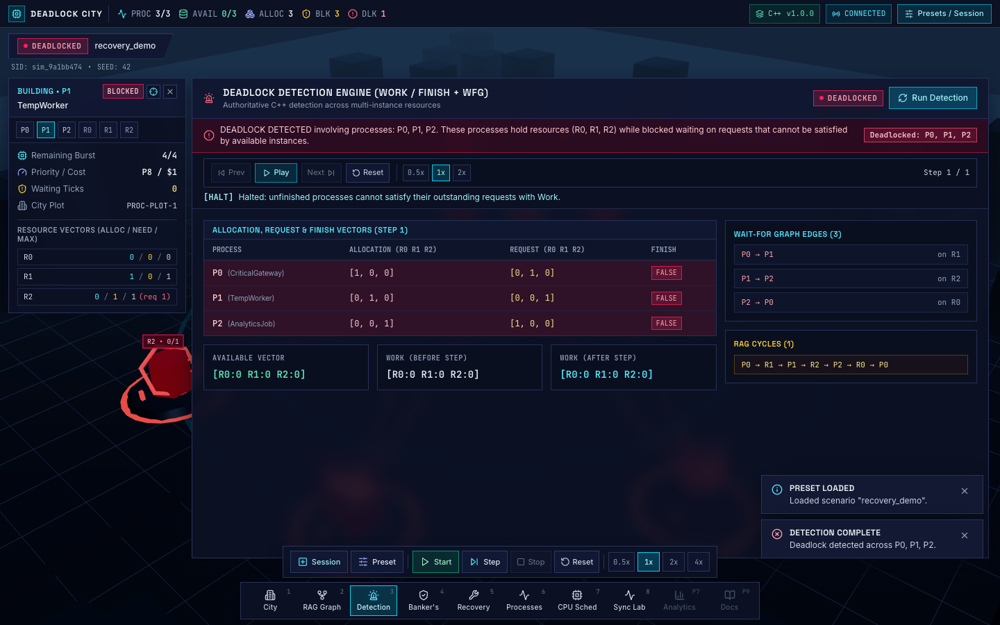

### 5.3 Banker's Algorithm Workbench (`Banker's [4]`)
1. Review live **`Allocation`**, **`Max`**, **`Need`**, and **`Available`** matrices plus the computed **`Safe Sequence`** (`e.g., P1 -> P3 -> P4 -> P0 -> P2`).
2. Select a process and enter a resource vector to **Evaluate Hypothetical Request** (runs `check_banker_safety` in C++ *without* modifying simulation state) to preview whether the request keeps the city `SAFE` or enters `UNSAFE`.
3. Click **Execute Request (Banker's ON)** to apply the decision directly to the live simulation.

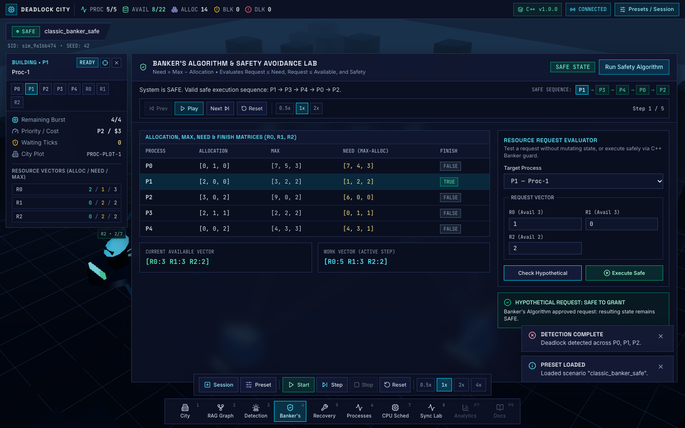

### 5.4 Deadlock Recovery Center (`Recovery [5]`)
1. Review deadlocked victim candidates (`Cost`, `Priority`, `Held Resources`), preemptible pools, and saved checkpoints.
2. Optionally click **`Save Checkpoint`** while the system is still `SAFE` before injecting a deadlock.
3. Choose a strategy:
   - **`Terminate Victim Process`** (ranked by `lowest_cost`, `lowest_priority`, `least_allocated`, or `lowest_remaining_work`)
   - **`Terminate All Deadlocked`**
   - **`Preempt Resource`** (for `preemptible: true` pools)
   - **`Rollback to Checkpoint`**
4. Click **`Execute Recovery Strategy`** and confirm inside the modal dialog (`Confirm Recovery`).
5. Review the **`Before -> After`** comparison banner (`e.g., DEADLOCKED -> SAFE`). If multiple disjoint deadlock cycles exist and one victim only breaks one cycle, the backend returns HTTP `409 DEADLOCK_UNRESOLVED` while still synchronizing your UI and WebSocket clients with the partial progress.

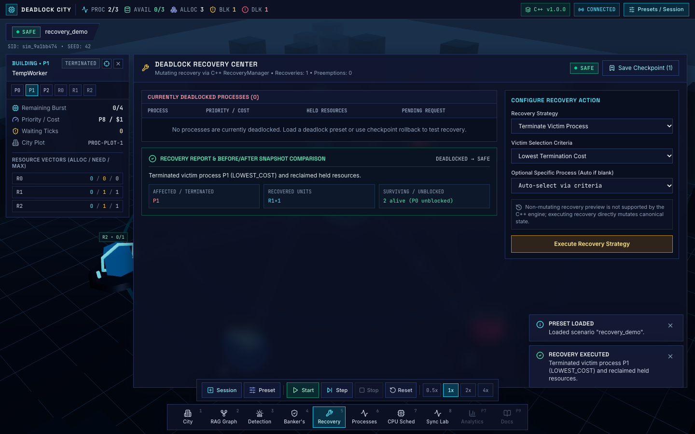

### 5.5 Process & Resource Manager (`Processes [6]`)
- **Processes Tab**: Inspect PCB state, suspend/resume active processes, terminate a process cleanly, spawn a new process (specifying name, arrival, burst, priority, termination cost, and `max_demand` per resource), or submit/release explicit unit vectors.
- **Resources Tab**: Scale `total_instances` (`+` / `-`), toggle `preemptible`, or create a new resource pool (`IO`, `LOCK`, `COMPUTE`, `MEMORY`, `STORAGE`).

### 5.6 CPU Scheduling Lab (`CPU Sched [7]`)
1. Edit the workload table or click **`Add Process`**, set the Round Robin **`Quantum`** (`1..64`), and click **`Compare All 5`** (or **`Run <Algorithm>`**).
2. Inspect each color-coded Gantt timeline—including explicit gray **`IDLE`** arrival gaps—alongside exact **Avg Waiting Time**, **Avg Turnaround Time**, **Avg Response Time**, **Context Switches**, and **CPU Utilization (%)**.

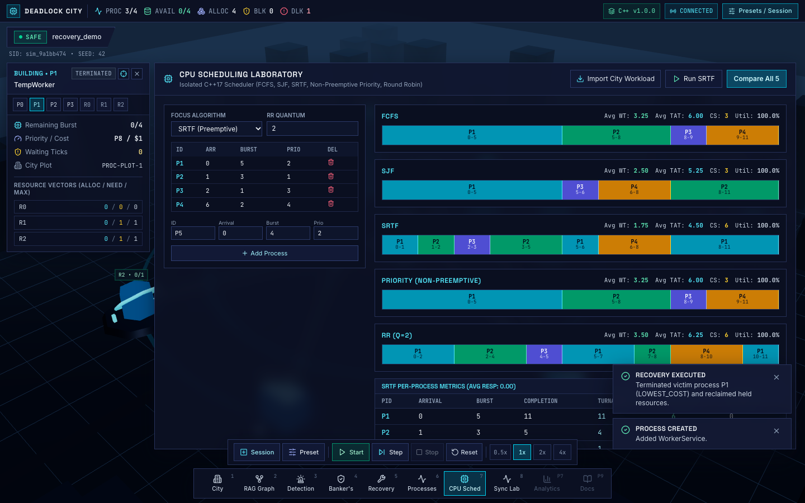

### 5.7 C++ Synchronization Lab (`Sync Lab [8]`)
1. Select **`Producer-Consumer`**, **`Readers-Writers`**, or **`Dining Philosophers`**.
2. Choose **`Safe (Synchronized)`** or **`Unsafe (Race / Contention)`**, configure **`Iterations`** and optional **`Buffer Capacity`**, and click **`Execute C++ Experiment`**.
3. Step through real C++ `std::thread` execution events inspecting buffer occupancy, active reader/writer counts, or fork ownership diagrams alongside overflow, underflow, or timeout totals.

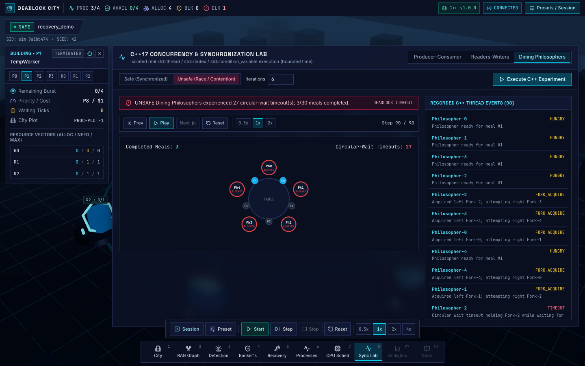

---

## 6. Analytics Command Center, Presets, Comparisons & Exports (`Analytics [9]`)

- **Command Center Tab**: Live OS KPI cards (tick, active/completed/waiting/blocked/terminated processes, instance utilization %, granted vs. rejected requests, deadlock & recovery counts, average waiting ticks), per-pool utilization bars, and full PCB telemetry matrix.

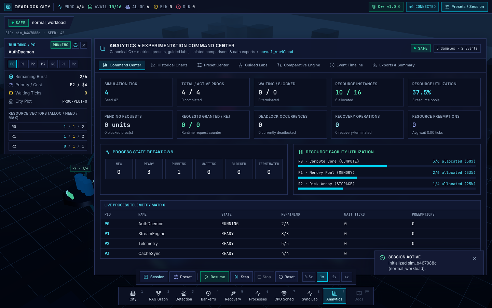

- **Historical Charts Tab**: 8 Recharts telemetry graphs over the bounded **240-sample** window with range selector (`All`, `Last 20`, `Last 10`, `Custom Ticks`), X-axis switch (`Sim Tick` vs `Real Time UTC`), retention window notice when older samples roll out of the buffer, and **`Accessible Table`** toggle for screen-reader/tabular inspection.

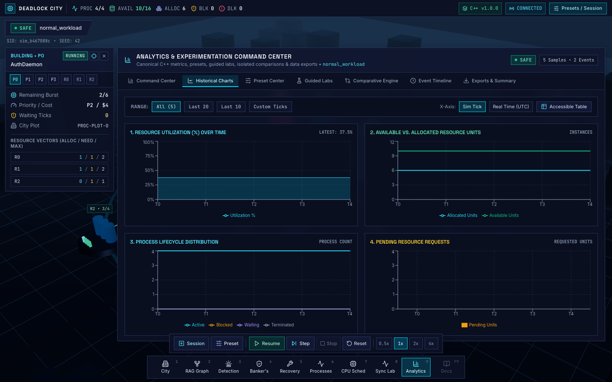

- **Preset Center Tab**: Load any of the 9 authoritative C++ presets with custom seed (including one-click deep links straight into `RAG`, `Detection`, `Banker`, or `Recovery`) or run the **Random Workload Generator** (`2..12` processes, `2..6` resources, deterministic `seed`).
- **Guided Labs Tab**: 6 structured classroom OS experiments (`Avoidance vs Immediate`, `Multi-Instance Safe Cycle`, `Unsafe vs Deadlocked`, `Victim Cost Comparison`, `Checkpoint Rollback`, and `Synchronization Races`) runnable directly against C++ telemetry.
- **Comparative Engine Tab**: Execute isolated side-by-side A/B comparisons (`avoidance`, `recovery`, `scheduling`, `synchronization`) **without mutating your active simulation session**.

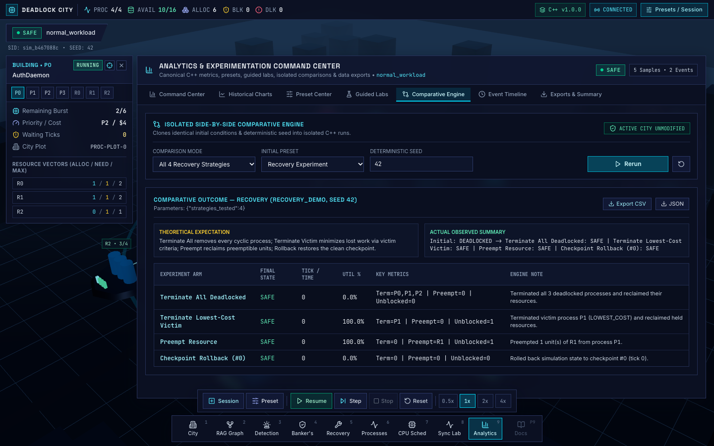

- **Event Timeline Tab**: Searchable, category- and severity-filterable log over the retained event window with one-click navigation directly into the relevant module and entity.
- **Exports & Summary Tab**:
  - Download server-generated **Simulation Snapshot (`.json`)**, **Simulation Metrics (`.csv`)**, **Event History (`.csv`)**, and **Comparative / Scheduling / Synchronization (`.csv` / `.json`)** reports containing units, UTC timestamps, and `total_metric_samples_recorded` / `total_events_recorded` retention counts.
  - Click **`Print Summary`** to print or save a clean white-background academic experiment sheet rendered via `@media print` CSS.
